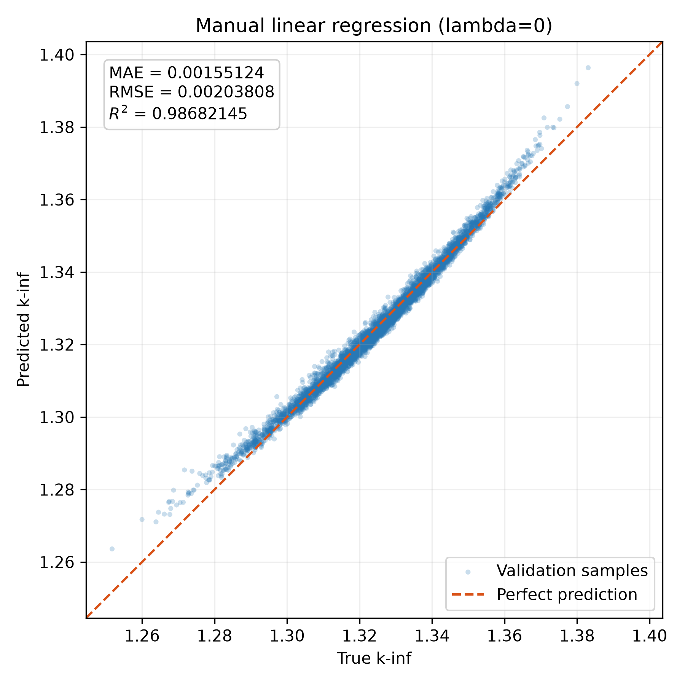
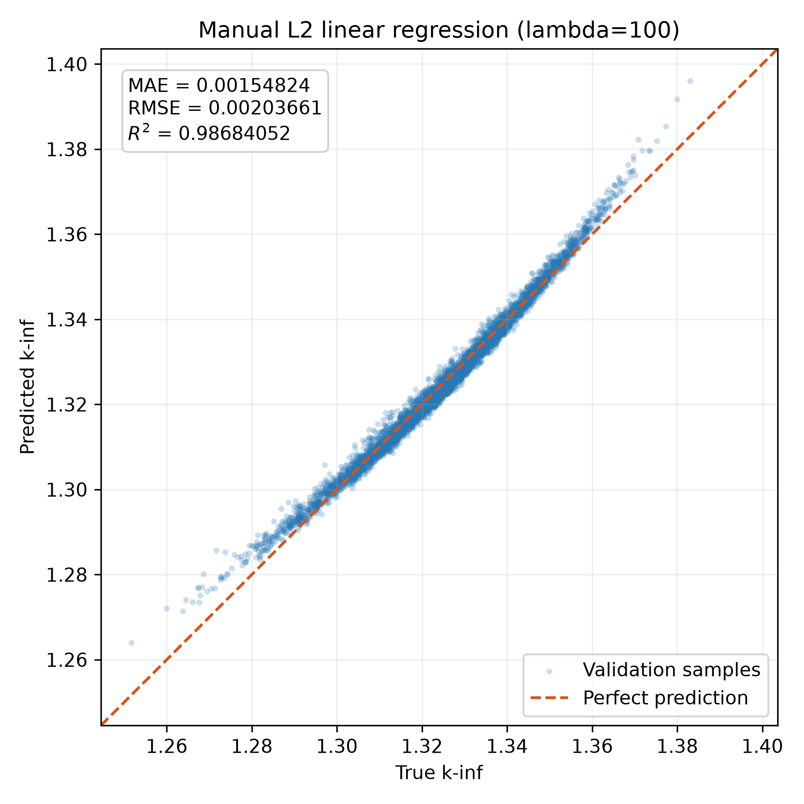
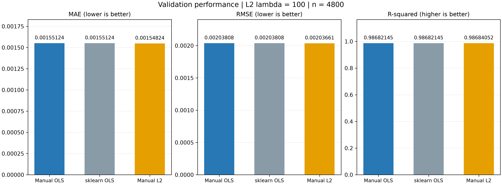

# 线性回归实验分析

## 1. 数据与实验设置

本实验使用 39 个燃料棒富集度特征预测 k-inf。通过公共数据接口读取 `raw.csv`，不使用另一个输出 PPPF 作为输入。文件列顺序沿用项目暂定约定，仍待来源确认。

使用随机种子 42，按 80%/20% 划分训练集与验证集，分别包含 19,200 和 4,800 个样本。所有模型使用相同划分，独立测试集不参与调参。

输入特征使用训练集均值和标准差进行标准化，验证集沿用训练集参数：

$$
x'_j = \frac{x_j-\mu_j}{\sigma_j}
$$

标准化与模型通过 Pipeline 组合，目标值保持原始尺度。

## 2. 模型与训练方法

### 2.1 普通线性回归

线性模型将标准化后的 39 个输入加权求和，得到预测值：

$$
\hat{y}^{(i)} = \sum_{j=1}^{39}w_jx_j^{(i)} + b
$$

使用平方误差作为训练目标：

$$
J(\mathbf{w},b) = \frac{1}{2m}\sum_{i=1}^{m}\left(\hat{y}^{(i)}-y^{(i)}\right)^2
$$

其中，$m$ 为训练样本数。手写实现采用全批量梯度下降，定义误差向量：

$$
\mathbf{e} = \mathbf{X}\mathbf{w} + b\mathbf{1}_m - \mathbf{y}
$$

权重和偏置的梯度分别为：

$$
\nabla_{\mathbf{w}}J = \frac{1}{m}\mathbf{X}^{\mathsf T}\mathbf{e}
$$

$$
\frac{\partial J}{\partial b} = \frac{1}{m}\sum_{i=1}^{m}e_i
$$

每次使用更新前的参数计算梯度，然后更新：

$$
\mathbf{w}^{(t+1)} = \mathbf{w}^{(t)} - \eta\nabla_{\mathbf{w}}J\left(\mathbf{w}^{(t)},b^{(t)}\right)
$$

$$
b^{(t+1)} = b^{(t)} - \eta\frac{\partial J}{\partial b}\left(\mathbf{w}^{(t)},b^{(t)}\right)
$$

权重和偏置均从零初始化，学习率为 0.01，迭代 2000 次。梯度使用 NumPy 矩阵运算计算。

### 2.2 L2 正则化

优化方案在原目标中增加 L2 权重惩罚：

$$
J_{\lambda}(\mathbf{w},b) = \frac{1}{2m}\sum_{i=1}^{m}\left(\hat{y}^{(i)}-y^{(i)}\right)^2 + \frac{\lambda}{2m}\sum_{j=1}^{39}w_j^2
$$

对应的权重梯度为：

$$
\nabla_{\mathbf{w}}J_{\lambda} = \frac{1}{m}\mathbf{X}^{\mathsf T}\mathbf{e} + \frac{\lambda}{m}\mathbf{w}
$$

偏置不参与惩罚，其梯度不变。$\lambda=0$ 时为普通线性回归，$\lambda>0$ 时约束权重大小。

选择该优化方向是为了检验：限制权重是否能够改善验证集表现。基础模型与正则化模型使用相同的初始化、学习率和迭代次数。

### 2.3 sklearn 对照

使用 sklearn 的 `LinearRegression` 检查手写普通回归的结果。两者采用相同的数据划分和标准化流程。

2000 次迭代后，手写模型与 sklearn 在验证集上的平均预测绝对差约为 $2.5\times10^{-9}$，最大差约为 $2.8\times10^{-9}$，指标在显示精度内一致。这表明本次手写梯度下降已接近普通最小二乘解。

## 3. 评价与参数选择

使用 MAE、RMSE 和 $R^2$ 评价预测效果。设评价样本数为 $N$：

$$
\mathrm{MAE} = \frac{1}{N}\sum_{i=1}^{N}\left|\hat{y}^{(i)}-y^{(i)}\right|
$$

$$
\mathrm{RMSE} = \sqrt{\frac{1}{N}\sum_{i=1}^{N}\left(\hat{y}^{(i)}-y^{(i)}\right)^2}
$$

$$
R^2 = 1 - \frac{\sum_{i=1}^{N}\left(y^{(i)}-\hat{y}^{(i)}\right)^2}{\sum_{i=1}^{N}\left(y^{(i)}-\bar{y}\right)^2}
$$

其中，$\bar{y}$ 为评价目标的均值。MAE 和 RMSE 越小越好，$R^2$ 越接近 1 越好。

固定其他设置，比较 $\lambda\in\{0,1,10,100,1000\}$，以验证 RMSE 最小作为选参标准。

| 正则化强度 $\lambda$ | 验证 MAE | 验证 RMSE | 验证 $R^2$ |
| ---: | ---: | ---: | ---: |
| 0 | 0.00155124 | 0.00203808 | 0.98682145 |
| 1 | 0.00155120 | 0.00203805 | 0.98682192 |
| 10 | 0.00155082 | 0.00203774 | 0.98682583 |
| 100 | 0.00154824 | 0.00203661 | 0.98684052 |
| 1000 | 0.00163926 | 0.00218990 | 0.98478497 |

$\lambda=100$ 在本次候选中验证 RMSE 最低，因此选为优化方案参数。验证集参与了选参，以下结果不作为独立测试结果。

## 4. 结果与分析

| 模型 | 训练 RMSE | 验证 MAE | 验证 RMSE | 验证 $R^2$ |
| --- | ---: | ---: | ---: | ---: |
| 手写普通回归 | 0.00204770 | 0.00155124 | 0.00203808 | 0.98682145 |
| sklearn 普通回归 | 0.00204770 | 0.00155124 | 0.00203808 | 0.98682145 |
| 手写 L2 回归，$\lambda=100$ | 0.00204977 | 0.00154824 | 0.00203661 | 0.98684052 |

手写普通回归与 sklearn 的结果基本一致。基础模型的训练和验证误差接近，未出现明显的训练与验证性能差距。

加入 $\lambda=100$ 的正则化后，训练 RMSE 略微上升，验证 RMSE 降低约 $1.4749\times10^{-6}$，相对改善约为 $0.0724\%$。改善幅度很小，不能据此宣称显著提升。

当 $\lambda=1000$ 时，训练 RMSE 上升至 0.00222896，验证 RMSE 上升至 0.00218990，说明过强的权重约束降低了模型的拟合能力。

本次实验表明，适度 L2 正则化带来的收益有限，增加正则化强度并不一定改善预测。最终泛化效果仍需由独立测试集评价。

### 4.1 真实值与预测值

两图使用相同坐标范围，虚线表示预测值等于真实值。大部分散点接近参考线，但两端存在向上偏离、点带略呈弯曲的现象，提示误差并非完全随机，线性表达能力可能存在限制；仅凭此图不能确定原因。正则化前后散点分布接近，与指标改善较小的结果一致。

### 4.2 性能比较

三项指标分别绘制，柱状图从零开始并标出具体数值。手写与 sklearn 普通回归基本一致，L2 的改善幅度较小。这里比较的是线性路线内的方案，团队最终算法比较还需加入树模型。

图片由运行命令生成，保存在被 Git 忽略的 `outputs/linear/`，未运行时这些本地图片链接不会显示。

## 5. 运行与模型交接

从项目根目录的 PowerShell 运行：

    $env:PYTHONPATH = 'src'
    .\.venv\Scripts\python.exe -m linear_regression.experiments.linear.run

代码依赖 Python 3.10+、NumPy、scikit-learn 和 Matplotlib。

`run.py` 中的 `build_model(variant)` 每次返回独立、未训练的 Pipeline：

- `baseline`：手写普通线性回归，$\lambda=0$。
- `optimized`：手写 L2 线性回归，$\lambda=100$。
- `sklearn`：库实现的普通线性回归，用于辅助对照。

手写模型统一采用学习率 0.01、迭代次数 2000。调用方直接传入原始尺度的特征，由 Pipeline 完成标准化：

    model.fit(X_train, y_train)
    predictions = model.predict(X_eval)

预测结果为一维数组，顺序与评价输入一致。正则化沿用本文的 $\lambda/(2m)$ 定义。正式评价与结果保存尚未接入公共工具，独立测试集尚未运行。

已检查模块导入不会自动启动实验；两种正式方案每次构建均返回独立、未训练的模型，并可通过 sklearn.clone 克隆。完整运行已生成上述三张图片，验证指标与记录一致。

### 模型构建与调用说明

`run.py` 包含模型构建、评价、绘图和本地实验流程，通过同一个 `build_model(variant)` 接口提供三种方案：

| variant | 模型 | 用途 |
| --- | --- | --- |
| `baseline` | 手写普通线性回归，L2 强度为 0 | 基础方案 |
| `optimized` | 手写 L2 线性回归，L2 强度为 100 | 优化方案 |
| `sklearn` | sklearn LinearRegression | 手写实现的辅助对照 |

两个手写模型均使用学习率 0.01、迭代次数 2000。

每次调用均返回独立、未训练的 Pipeline。三个方案均包含标准化步骤，调用方直接传入原始尺度的特征，不要重复标准化。

导入模块不会自动训练或画图；直接运行模块才会执行三种方案的完整实验。

当前模块依赖 NumPy、scikit-learn 和 Matplotlib。