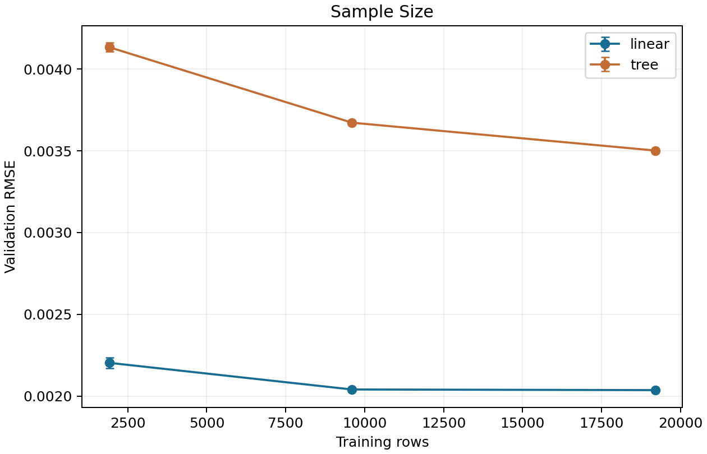
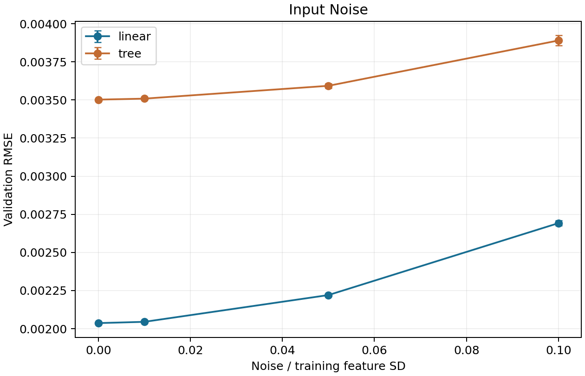

# 泛化与输入噪声分析

## 问题与范围

`raw.csv` 来自同一模拟数据生成过程，当前固定验证集上的误差较低。这说明模型在该划分所代表的分布上有较好的预测能力，不能单独证明样本减少或输入受扰动时也稳定。本实验固定验证集，只在开发数据内考察这两种变化；它不代表所有真实工况，也不使用独立 `test.csv`。

## 可复现实验协议

- 模型：线性路线与随机森林路线各自的 `build_model('optimized')`。两模型始终使用相同训练行及评价行。
- 样本量：固定训练集的 10%、50%、100%。种子 42、43、44 各产生一套随机排列；每套的 10% 子集包含在 50% 子集中。100% 保持原训练行顺序，只训练一次。评价集始终为原验证集。
- 输入噪声：两模型均使用完整训练集拟合。对验证输入副本加入独立正态噪声，逐特征噪声标准差等于训练集该特征总体标准差乘以 0%、1%、5% 或 10%。非零档使用种子 101、102、103；相同种子的基础随机矩阵和扰动输入对两模型一致。训练输入、目标及验证目标均不变。
- 噪声不裁剪到富集度 0.7–5.0 范围；输出中记录超出范围的输入单元比例。含越界输入的条件属于压力测试，不能直接解释为物理上可行的燃料组件。
- 每个条件报告 MAE、RMSE、R²。样本量与噪声趋势图以重复条件的平均 RMSE 为曲线，误差棒为重复条件的标准差；100% 和 0% 条件各只有一次，无重复方差估计。

从仓库根目录设置 `PYTHONPATH=src`，运行 `python -m linear_regression.experiments.robustness.run`。所有指标、预测、协议和图生成到 `outputs/robustness/`。`results.csv` 为汇总，`protocol.json` 记录原始数据哈希、固定划分和随机设置；每个条件的 `metrics.json` 与 `predictions.csv` 可逐行核对。仓库保留汇总、协议和趋势图；详细逐条件文件可本地重生成。

## 实测结果

以下为固定验证集的实测值。10% 与 50% 样本量以及非零噪声条件均为三个种子的指标平均值；100% 和零噪声各运行一次。完整数值见 `outputs/robustness/results.csv`。

| 条件 | 线性 MAE | 线性 RMSE | 线性 R² | 树 MAE | 树 RMSE | 树 R² |
| --- | ---: | ---: | ---: | ---: | ---: | ---: |
| 10% 训练样本 | 0.001650 | 0.002203 | 0.984595 | 0.003261 | 0.004134 | 0.945789 |
| 50% 训练样本 | 0.001550 | 0.002040 | 0.986790 | 0.002898 | 0.003672 | 0.957215 |
| 100% 训练样本 | 0.001548 | 0.002037 | 0.986841 | 0.002762 | 0.003502 | 0.961092 |

线性模型在 10% 样本时的 RMSE 比完整训练高约 8.19%，树模型高约 18.04%。增加到 50% 后，线性模型已接近完整训练结果；树模型仍有可见收益。因此，在当前固定验证集和这些样本量下，树模型对训练数据规模更敏感。这里没有用独立测试集估计最终泛化误差。

| 验证输入噪声强度 / 训练特征标准差 | 线性 MAE | 线性 RMSE | 线性 R² | 树 MAE | 树 RMSE | 树 R² | 越界输入单元比例 |
| --- | ---: | ---: | ---: | ---: | ---: | ---: | ---: |
| 0% | 0.001548 | 0.002037 | 0.986841 | 0.002762 | 0.003502 | 0.961092 | 0% |
| 1% | 0.001555 | 0.002045 | 0.986734 | 0.002768 | 0.003508 | 0.960946 | 0.234% |
| 5% | 0.001708 | 0.002220 | 0.984358 | 0.002837 | 0.003593 | 0.959050 | 1.138% |
| 10% | 0.002109 | 0.002692 | 0.977006 | 0.003075 | 0.003890 | 0.951993 | 2.312% |

10% 噪声时，线性模型 RMSE 相对自身无噪声结果增加约 32.19%，树模型增加约 11.08%。线性模型在各档的**绝对**误差仍低于树模型；树模型的**相对**误差增幅较小。二者回答不同问题，不能只凭相对增幅称树模型整体更好。图中的误差棒只反映本协议中三个随机种子的波动，不是总体泛化误差的置信区间。

这里保持原始验证目标不变，模拟的是**输入测量误差**，不是物理富集度实际改变后的反应堆输出。10% 噪声时约 2.312% 的输入单元超出来源给出的富集度范围，进一步限制了物理解释。当前证据支持在本协议下量化误差敏感性，不支持推断真实部署环境或所有分布偏移下的鲁棒性。
