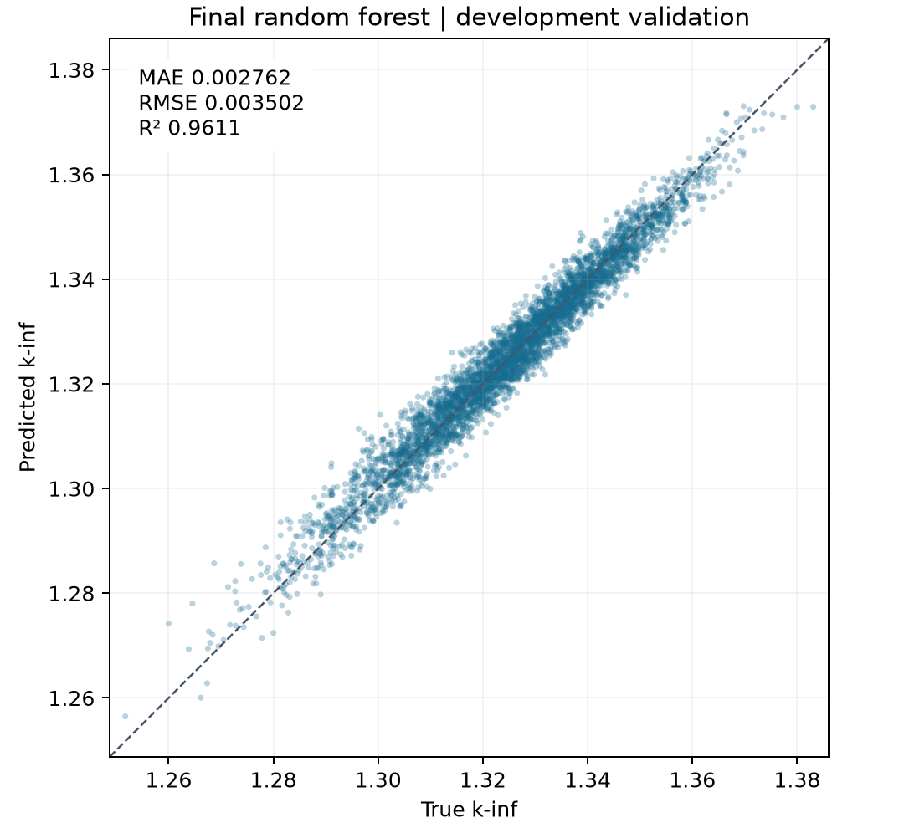
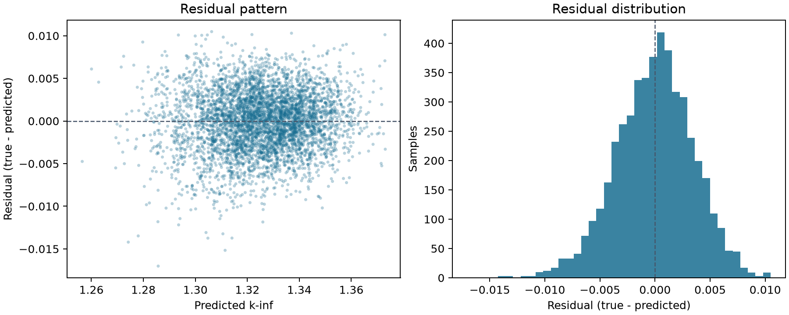

# 树模型：均值特征与随机森林

负责角色：3 号。实验日期：2026-11-07。本目录只保留最终模型及其复现入口。

## 数据与方法

任务是用 39 个燃料棒富集度预测连续变量 `k-inf`。复用公共 `data.py`，按种子 42 将 24,000 条开发样本划分为 19,200 条训练样本和 4,800 条验证样本。另一个输出 `PPPF` 不作为输入，原始数据不改动。数据说明见 [data.md](data.md)。

文件沿用项目暂定列约定：第 1 列为 `k-inf`，第 2 列为 `PPPF`，其余 39 列为输入。来源尚未正式确认这一列顺序，该假设仍需保留。

最终模型是 `Pipeline(AddMeanFeature → RandomForestRegressor)`。它保留原始 39 列，再追加当前样本的输入均值：

`m(x) = (x_1 + x_2 + ... + x_39) / 39`

均值按行计算，不使用标签或其他样本的分布；模型对外接收 39 列，内部森林使用 40 列。这个统计特征帮助树直接利用整体输入水平，但不表示 39 个位置具有相同物理权重。

随机森林通过 bootstrap 样本训练多棵回归树并平均预测。本模型采用平方误差分裂；叶节点输出区域训练目标的均值。不额外标准化、删特征或变换目标。[算法说明](https://scikit-learn.org/stable/modules/generated/sklearn.ensemble.RandomForestRegressor.html)

## 固定模型规格

| 参数 | 值 |
| --- | --- |
| 树数 | 200 |
| 每次分裂考虑的特征 | 全部内部特征，`max_features=1.0` |
| 叶节点最少样本 | 1 |
| 最大深度 | 不限制 |
| bootstrap | 启用 |
| 模型随机种子 | 42 |

规格由训练内部比较确定，保存在 [params.json](../../src/linear_regression/experiments/tree/params.json)。当前代码只训练这个固定模型，不再包含其他模型或参数搜索。资源参数 `--threads` 不改变统计规格；预测采用串行聚合以便复现。

## 已核验性能

| 评价 | MAE | RMSE | R² |
| --- | --- | --- | --- |
| 开发验证集（4,800 条） | 0.00276236 | 0.00350186 | 0.961094 |
| 训练内三折拼接 OOF（种子 2026） | 0.00284735 | 0.00360912 | 0.958928 |

训练 RMSE 为 0.00130527。三折 RMSE 依次为 0.00358753、0.00359236、0.00364716，平均 0.00360902，折间标准差 0.00002704。拼接 OOF 指标由各行折外预测共同计算，不能直接用各折 R² 或 RMSE 的均值替代。

预测整体接近理想直线，但仍有训练／评价差距和目标两端偏差，不能认为过拟合已被消除。开发验证集此前已查看；三折复核也重用了训练观察值，因此均不构成独立测试或跨分布泛化保证。独立 `test.csv` 留给 0 号最终评估，未用于本次模型训练、选择或分析。

## 运行与交接

源码只分为模型定义 `model.py`、运行与输出 `run.py`、测试 `test_tree.py`。安装和命令见 [README](../../src/linear_regression/experiments/tree/README.md)。普通运行将重新拟合当前模型；`--cv` 只对当前固定模型做训练内三折检查，不重新选参。

每次运行生成的指标、逐样本预测和图表写入 `outputs/tree/`。参数文件保留数据与划分指纹，兼容 Git 在 Windows／Linux 间转换换行符；真实数据内容变化仍会被拒绝。

0 号或 4 号调用 `build_model('optimized')` 可得到独立未训练 Pipeline，直接传入原始 39 列即可。样本量／噪声拓展、团队模型比较和最终独立测试由相应负责人完成。
